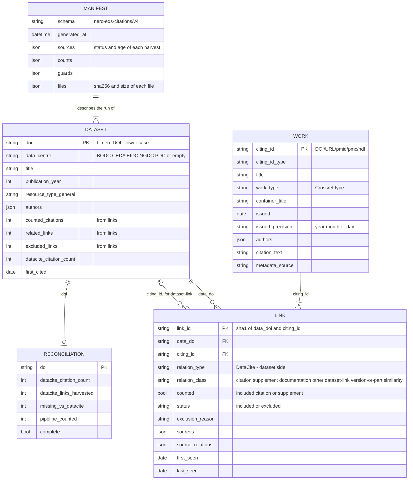

# NERC EDS dataset citations

Harvests the links between NERC Environmental Data Service datasets (DataCite client `bl.nerc`) and the works that cite or relate to them. Each link gets a class, and the results are published in `Results/v4`, which the EDS citation API, the citation widget and the data centres' cited-data catalogues read. A v3-compatible copy is still written to `Results/v3` while consumers move over.

This is not a census of every citation. It covers what DataCite, Scholexplorer, Overton and Crossref expose openly.

## What changed from v3

v3 was five notebooks run by five scheduled workflows, with pickles committed between stages. A review in October 2026 found gaps that had built up unnoticed. Version 4 replaces the notebooks with a `citations` package, one CLI, one workflow and a SQLite store.

| v3 problem | v4 |
| --- | --- |
| The DataCite stage asked only for `is-cited-by`, `is-referenced-by` and `is-supplement-to` with the dataset as subject. It never saw citations from journal reference lists, which Crossref deposits as `references` events with the article as subject. These were 99% of the DataCite links missing from v3. | Harvests the exact list behind DataCite's `citationCount` for every cited dataset, labelled from its events. It also reads incoming relations from the datasets' own `relatedIdentifiers`. |
| Scholexplorer similarity recommendations (`HasAmongTopNSimilarDocuments`) were counted as citations: 44% of v3 rows. | Every link has a `relation_class`. Similarity and dataset-to-dataset links are published as related links and never counted. |
| Overton read only the first dataset each policy document cites. Its API key was in the code. | Every highlight is used. The key comes from the `OVERTON_API_KEY` secret (**rotate the old key**: it is in the git history). |
| The inventory used page-number paging with no completeness check: 12 DOIs were missing and 10 were duplicated. | Cursor paging, de-duplication, and the run fails if the count differs from DataCite's total. |
| Links were deleted by filters, and before Sept 2026 some were dropped without a record. Publication dates were the DOI registration date, written as D/M/YYYY. The pre-dates rule used a one-year cut. | Exclusions are kept with a `status` and `exclusion_reason`. Dates are the `issued` date in ISO 8601, with their precision. The pre-dates rule needs a gap of **two years or more**. |
| Each stage committed whatever it produced; an empty Scholexplorer harvest was published for 8 months. | A harvest only replaces the previous one when it succeeds. Publishing is refused when a required source failed, is stale or lost rows, and an issue is opened. |
| De-duplication used raw strings, so URL case variants survived, and only the first source was credited. | Identifiers are normalised and every source that found a link is listed. |

## Running it

```
pip install -e ".[test]"
export CITATIONS_MAILTO=you@example.org     # Crossref / DataCite polite pools
export OVERTON_API_KEY=...                   # optional; Overton is skipped without it
python -m citations all                      # the weekly run
python -m citations status                   # what ran and what is used
```

Stages can be run separately. Each one reads and writes the store at `data/citations.sqlite` (change it with `--db`):

| Command | Does |
| --- | --- |
| `inventory [--snapshot F] [--save-snapshot F]` | Every DOI of `bl.nerc`, checked against DataCite's total. `--snapshot` rebuilds from a saved download. |
| `harvest [datacite scholexplorer overton crossref] [--no-resume] [--accept-drop S …]` | Harvests the sources, all at the same time. A harvest that was interrupted or partial, and started in the last 8 days, resumes and retries only what failed, so the next weekly run picks it up. `--accept-drop`: see [Guards](#guards). |
| `works` | Metadata and a plain-text citation string for each citing work, cached and refreshed every 90 days, and saved as it is fetched. |
| `merge` | One link per dataset × citing work from each source's latest good harvest, classified and filtered. |
| `publish [--force] [--no-v3] [--accept-drop S …]` | Writes `Results/v4` and `Results/v3` if the guards pass. `--force` publishes anyway and records that in the manifest. |
| `reconcile` | Compares each dataset with DataCite's `citationCount`. |

Exit codes: 0 success, 1 a stage failed, 2 publishing was blocked by a guard.

### Speed and rate limits

The run spends almost all its time waiting on the APIs, within their published rate limits, so it overlaps that waiting rather than using more processes:

- The four sources are harvested at the same time, one thread and one store connection each. Each calls a different API, so the harvest takes as long as the slowest source (usually Crossref's data citations, which allow 3 list requests a second) instead of the sum.
- Within a source, and for citing-work metadata and citation strings, requests run in parallel (`--workers`, default 4), up to each API's limit.
- `citations/http.py` paces every request to the API's published limit (requests per second, and requests at once), just under it: Crossref's polite pool, 10/s for single records, 3/s for lists, 3 at once; DataCite, 1,000 requests per 5 minutes, which is also its cap for citation strings from DataCite DOIs; Overton, one a second. Without `CITATIONS_MAILTO` the lower anonymous limits are used. A slow API never holds up requests to the others.
- While harvesting, each source logs a progress line every minute: how many it has fetched, how fast, errors, rate-limited (429) responses so far and an estimate of the time left. Results are saved as each request finishes, so one slow request doesn't hold the rest back.
- Each harvest run and the works run record `throttled_429`, the number of rate-limited responses they got (see `python -m citations status` or the store), so a limit that has changed shows up.
- Harvested links, citing-work metadata and citation strings are saved as they arrive. A run stopped by the job's time limit keeps what it fetched, and the next run carries on from there.

### The weekly workflow

`.github/workflows/citations.yml` runs every Sunday: tests, then `python -m citations all`, then it commits `Results/v4` and `Results/v3`. The SQLite store is carried between runs in the Actions cache. If the cache has been evicted, the run rebuilds it from scratch, which takes longer, and first-seen dates come from the published `links.csv`. The store and the DataCite snapshot are also kept as a 30-day run artifact. A failed or blocked run opens or updates an issue labelled `citations-pipeline`, and the previous results stay as they were.

Set the repository secret `OVERTON_API_KEY` and the variable `CITATIONS_MAILTO`.

A manual run ("Run workflow") takes three optional inputs: `force` (publish even if a guard fails), `skip` (sources not to harvest) and `accept_drop` (sources whose drop in links is real; see [Guards](#guards)).

#### Testing on a fork before a pull request

GitHub only starts scheduled and manual runs from a repository's default branch. To test a branch such as `v4` on a fork:

1. In the fork, enable Actions, and under Settings → Actions → General → Workflow permissions choose "Read and write".
2. Add the secret `OVERTON_API_KEY`, and the variables `CITATIONS_MAILTO`, `CITATIONS_BRANCH` = `v4` and, to keep result commits out of the branch you will open the pull request from, `CITATIONS_COMMIT_RESULTS` = `false`. The results are still uploaded as a run artifact.
3. Push a change under `citations/`, to `pyproject.toml` or to the workflow on `v4` to start a run. Use "Re-run all jobs" on that run to repeat it.

Upstream needs none of these variables: the workflow runs on the default branch, and pushes do not start it.

## Checking the results

`inspect_results.ipynb` validates and summarises what has been published. It calls no citation API. Install with `pip install -e ".[notebook]"`, open it, and in the Settings cell choose a `Results` folder or this repository on GitHub at a branch, tag or commit, and optionally a second version to compare with.

- **Validation** (PASS / WARN / FAIL / INFO, with the failing rows written to `inspect_outputs/`): `Results/v4` against the format below, its integrity, the counting rules, the manifest and the reconciliation; `Results/v3` for CSV–JSON parity and data quality, and, when v4 is present, that it holds exactly v4's counted links; and that the v3 files keep the shape and types of upstream's (`UPSTREAM_REPO` at `UPSTREAM_REF`), which the EDS citation API reads: the same columns in the same order, the same encoding, and no kind of value a column or JSON field has never had upstream (the full comparison is written to `inspect_outputs/v3_schema_vs_upstream.csv`).
- **Overview**: counted citations and related links per data centre, sources and how often they agree, exclusions, metadata completeness, the most-cited datasets, citations by UK fiscal year, and links new since a date.
- **One dataset**: `show_dataset(doi)`.
- **Comparison** with the other version: per-dataset changes, and `compare_dataset(doi)` for new, gone and unchanged citing works. A legacy v3 version is classified with the v4 rules first, so counts compare like for like.

## Counting rules

A **link** is one dataset and one citing work, with every source that reported it. Relations are stored in the DataCite vocabulary *from the dataset's side*: `IsCitedBy` means the other work cites the dataset. Relations where the dataset is the one citing or deriving (`References`, `Cites`, `IsDerivedFrom`, `IsCompiledBy` …) are not links to the dataset and are dropped at harvest.

| `relation_class` | From | Counted |
| --- | --- | --- |
| `citation` | `IsCitedBy`, `IsReferencedBy` | yes |
| `supplement` | `IsSupplementTo`, `IsSupplementedBy` (either direction) | yes |
| `documentation` | `IsDocumentedBy`, `IsDescribedBy`, `IsReviewedBy` | no, related |
| `other` | `IsRequiredBy`, `IsSourceOf`, `Compiles` | no, related |
| `dataset-link` | any of the above where the other work is itself a NERC dataset (`10.5285/…`) | no, related dataset |
| `version-or-part` | `IsPartOf`, `HasPart`, `IsNewVersionOf`, `IsPreviousVersionOf` … | no, related dataset |
| `similarity` | Scholexplorer `HasAmongTopNSimilarDocuments` | no, related dataset |

When sources disagree about one pair, the most specific class wins: citation, then supplement, documentation, other, version-or-part, similarity.

`counted` is true for included `citation` and `supplement` links. The catalogue and widget should show the rest as *related datasets and documents*, never in the citation count.

Preprints are counted like any other citing work, whether or not they have since been published. A preprint and the article it became are not yet merged, so a dataset cited by both is counted twice (see [Known limitations](#known-limitations)).

A link is **excluded**, but still published, when the first of these applies:

| `exclusion_reason` | Rule |
| --- | --- |
| `self-link` | the citing work is the dataset |
| `comment` | title starts "Comment on", "Reply on", "Reply to comment by", "Final response" or "Author response" |
| `peer-review` | the work type is a peer review |
| `conference-abstract` | an EGU General Assembly abstract (`10.5194/egusphere-egu…`). Other EGUsphere DOIs are preprints and are counted |
| `gbif-download` | a GBIF download DOI (`10.15468/…`) |
| `predates-data` | the work was issued **two or more years** before the dataset's publication year (citation, supplement, documentation and other links only) |

## Results/v4

Bare lower-case DOIs; ISO 8601 dates; empty means null (no "Info not given"); lists and objects are JSON (a JSON string in CSV cells); JSON files are flat arrays that carry `data_centre`. Rows are sorted, so their order is stable between runs. Every run sets `last_seen` on every link it still finds, so each week every row of `links.csv` and `links.jsonl` changes; the other files change only where the data does.

| File | One row per |
| --- | --- |
| `datasets.csv`, `datasets.json` | `bl.nerc` DOI, cited or not |
| `links.csv`, `links.jsonl` | dataset × citing work, excluded links included |
| `works.csv`, `works.json` | citing work |
| `reconciliation.csv` | dataset cited by DataCite or by the pipeline |
| `manifest.json` | run: sources and their status and age, counts, guard results, reconciliation summary, and the sha256 and size of every other v4 file, so a reader can check it fetched one consistent set |

How the files fit together: a link joins one dataset to one citing work, and every link, work
and reconciliation row comes from the same run, which the manifest describes. When the citing
work is itself a NERC dataset, its `citing_id` is that dataset's DOI and the link is a
`dataset-link`.



**links**

| Field | Notes |
| --- | --- |
| `link_id` | sha1 of `data_doi` + `|` + `citing_id`; stable across runs |
| `data_doi`, `data_centre` | `data_centre` is `BODC`, `CEDA`, `EIDC`, `NGDC`, `PDC` or empty |
| `citing_id`, `citing_id_type` | DOI if there is one, else a canonical URL, `pmid:…`, `pmc:…` or `hdl:…`; type `doi`, `url`, `pmid`, `pmc`, `handle` |
| `relation_type` | DataCite vocabulary, from the dataset's side |
| `relation_class`, `counted` | see the counting rules above |
| `status`, `exclusion_reason` | `included` / `excluded` and why |
| `sources` | e.g. `["datacite:crossref", "scholexplorer"]`. DataCite links are labelled by origin: `datacite:crossref` (journal reference lists), `datacite:metadata` (the data centre's relatedIdentifiers) |
| `source_relations` | the raw relation each source reported, for audit |
| `first_seen`, `last_seen` | replace `date_added`; seeded from v3's `date_added` on the first run |

**works**: `citing_id`, `citing_id_type`, `title`, `work_type` (a [Crossref type](https://api.crossref.org/types) such as `journal-article`, `posted-content` or `dataset`; DataCite, Scholexplorer and Overton types are mapped to it, Overton's policy documents are `report`, `other` when no Crossref type fits and empty when nothing is known about the work), `container_title`, `publisher`, `issued`, `issued_precision` (`year`, `month`, `day`), `authors` (array of `{given, family, name, orcid}`), `citation_text` (formatted by the DOI's registration agency, else built from the work's metadata, else a link to the work: its URL, or its doi.org, PubMed, PMC or handle link), `metadata_source` (`crossref`, `datacite`, `inventory`, or the harvesting source when no DOI metadata exists), `fetched_at` (empty when the Crossref or DataCite lookup failed: the source's own metadata is used until the next run retries it).

**datasets**: `doi`, `data_centre`, `data_centre_name`, `publisher`, `title`, `publication_year`, `resource_type_general`, `registered`, `authors`, `counted_citations`, `related_links`, `excluded_links`, `datacite_citation_count`, `first_cited` (issued date of the earliest counted citing work).

**reconciliation**: for each dataset, DataCite's `citationCount`, how many of DataCite's citing works were harvested, and how those were classified. A run fails the guard when more than 5% of DataCite-cited datasets have fewer harvested DataCite links than their `citationCount`.

## Results/v3 (deprecated)

Still written each run, from v4: included, counted links only, with `date_added` taken from `first_seen`. The EDS citation API reads these files, so they keep the v3 pipeline's shape and types: the same 18 columns (14 in `filtered_out_df.csv`) in the same order, the same encodings (`latest_results.csv` with a BOM, `filtered_out_df.csv` without), the JSON on one line, `data_publication_year` as a float (`2012.0`), and v3's placeholder text where a value is missing (`No title given` for `data_title`; `Info not given` for `publication_title`, `pub_publisher` and `publication_type`), never an empty cell or `null`. Section 1c of `inspect_results.ipynb` checks this against upstream's files. Differences in content consumers may notice:

- **Fewer, more accurate rows.** Similarity, dataset-to-dataset and version links are no longer in it.
- EGUsphere preprints (`10.5194/egusphere-2023-…`) are in it. v3 excluded every EGUsphere DOI as a conference abstract; only EGU General Assembly abstracts are excluded now.
- `publication_date` is ISO 8601 at the precision known: `YYYY-MM-DD`, `YYYY-MM` or `YYYY` (was D/M/YYYY).
- `publication_authors` is a list of `"Family, Given"` strings for every source (DataCite rows were a list of `[given, family]` pairs).
- A work with no authors has `publication_authors` `[]` (was `Info not given` or `not a doi`).
- `publication_type` is a Crossref type on every row (`journal-article`, `posted-content` …), as it was for most rows before; Scholexplorer's and Overton's `Publication` become `other` and `report`.
- `PubCitationStr` is never empty: a work with nothing to build a citation from has a link to it instead.
- `relation_type_id` is the dataset-side relation in kebab case (`is-cited-by`).
- `citation_event_source` is one of `datacite`, `scholex`, `overton`, `crossref`.
- Why each link in `filtered_out_df.csv` was excluded is in `Results/v4/links.csv` (`exclusion_reason`); the v3 file keeps its 14 columns.

`Results/v1` and `Results/v2` are no longer updated.

## Guards

Publishing is refused (exit code 2, previous results kept, an issue opened) when:

- the inventory, DataCite or Scholexplorer has no successful harvest in the last 8 days, or its latest run failed, was partial or was rejected;
- a harvest lost more than 20% of its links compared with the last good harvest, or the published links of a required source fell by more than 20% compared with the last manifest;
- more than 2% of a source's requests failed (the harvest is *partial* and resumes next run);
- reconciliation with DataCite is incomplete for more than 5% of DataCite-cited datasets.

Overton and Crossref are optional: their failures produce warnings in the manifest, and their last good harvest is used.

**When a drop is real.** If a source really has lost links (for example Scholexplorer stops serving similarity links), every harvest of it would be rejected and, after 8 days, publishing blocked. Once you have checked the drop, run with `--accept-drop SOURCE` (`python -m citations all --accept-drop scholexplorer`, or the workflow's `accept_drop` input). That harvest becomes the source's good harvest and publishing is not blocked by the drop. Both are recorded: in the harvest run's details and as a warning in `manifest.json`. Unlike `--force`, it only waives the drop check, and only for the sources named.

## Known limitations

**The same work under two identifiers is counted twice.** Links are de-duplicated on normalised identifiers, so different spellings of one DOI or URL become one link. Different identifiers for one work are not merged. Matching titles within each dataset in the October 2026 results found about 520 extra counted links (about 6%). Most are one of three kinds:

- **A preprint and its published article** (about 370 links). Most are Copernicus discussion papers and their final papers, such as `essd-2025-67` and `essd-18-1243-2026`. The rest are on servers such as bioRxiv, Research Square and EarthArXiv.
- **A DOI and the same work as an OpenAIRE or repository URL** (about 85 links).
- **Version DOIs of one Zenodo or figshare record** (about 20 links).

The planned fix:

1. Link a preprint to its article using Crossref's `is-preprint-of` relation. Copernicus deposits it, but some preprint servers don't, so where it is missing, fall back to a matching title and first author within one dataset.
2. Count the published version, and publish the preprint link as excluded with its own `exclusion_reason`.
3. Keep counting a preprint that has no published version.

## Development

```
pytest                      # offline: a fake HTTP layer stands in for every API
```

`.github/workflows/tests.yml` runs the tests on Python 3.10 and 3.12 for every pull request and every push to `main`.

The modules are `citations/inventory.py`, `citations/sources/{datacite,scholexplorer,overton,crossref}.py`, `citations/works.py`, `citations/merge.py`, `citations/filters.py`, `citations/relations.py`, `citations/publish.py`, `citations/guards.py`, `citations/reconcile.py` and `citations/worktypes.py`. The store's schema is in `citations/db.py`. Citation strings (`citations/citation_text.py`) are ported unchanged from v3's `getCitationString`.

## Authors

Matthew Nichols (UKCEH) wrote the original pipeline. The Crossref functions were adapted from the demo notebooks in the Crossref [rest-api-doc](https://github.com/CrossRef/rest-api-doc) repository.