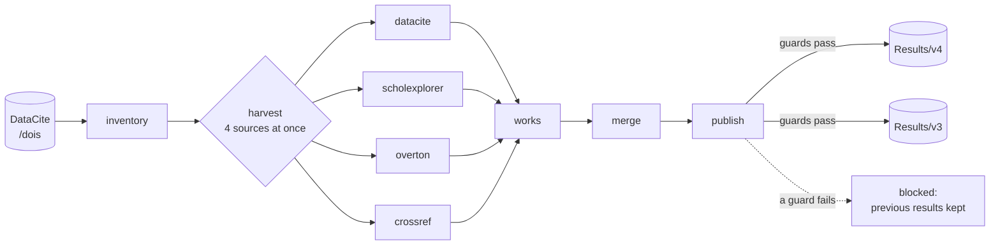

# Architecture

> One Python package, one command, one weekly workflow and one SQLite store. v3 was five notebooks run by five workflows, with pickles committed between them.

## Stages



| Stage | Reads | Writes to the store | Page |
| --- | --- | --- | --- |
| `inventory` | DataCite REST API, or a saved snapshot | `datasets`, `dataset_relations` | [Inventory](../3-features/inventory.md) |
| `harvest` | Each source's API | `raw_links`, `fetch_log` | [Sources](../3-features/sources.md) |
| `works` | Crossref, DataCite and DOI content negotiation | `works` | [Works and citation strings](../3-features/works-and-citations.md) |
| `merge` | `raw_links` of each source's good run, `works`, `datasets` | `links`, `link_history` | [Merge and classification](../3-features/merge-and-classification.md) |
| `publish` | Everything above | Files in `Results/v4` and `Results/v3` | [Publishing and guards](../3-features/publishing-and-guards.md) |

`python -m citations all` runs them in order. Each can also be run on its own; see [Setup](../5-technical/setup.md).

Every stage records a **run** in the store with its status. A source's harvest only becomes its **good run** when it succeeds, and later stages only read good runs, so a failed or partial harvest never replaces good data. See [Data store](../5-technical/data-store.md).

## Modules

```
citations/
├── __init__.py        version
├── __main__.py        python -m citations
├── cli.py             the command line and the "all" run
├── config.py          Settings, sources, data-centre mapping
├── db.py              SQLite schema and run bookkeeping
├── http.py            the HTTP client: retries, rate limits, 429 counting, parallel map
├── inventory.py       stage 1: every DOI of the DataCite client
├── harvest.py         running a source: resume, error rate, row-drop check, good run
├── sources/
│   ├── datacite.py      citations DataCite counts, and relations in dataset metadata
│   ├── scholexplorer.py OpenAIRE Scholexplorer (Scholix v3)
│   ├── overton.py       policy documents
│   └── crossref.py      Crossref data citations (beta)
├── works.py           citing-work metadata and citation strings
├── citation_text.py   citation formatting and plain-text clean-up (ported from v3)
├── worktypes.py       one work-type vocabulary: Crossref's
├── ids.py             identifier normalisation and link ids
├── relations.py       relation vocabulary, direction and class
├── filters.py         exclusion rules
├── merge.py           one classified link per dataset and citing work
├── reconcile.py       comparison with DataCite's citationCount
├── guards.py          the checks before publishing
└── publish.py         writing Results/v4 and Results/v3, and the manifest
```

## Concurrency

The run spends nearly all its time waiting on APIs, so it overlaps the waiting rather than using more processes:

- the four sources are harvested at the same time, one thread and one store connection each;
- within a source, and in the works stage, requests run in a pool of worker threads (`--workers`, default 4);
- one shared HTTP client keeps every request within its API's rate limit across all threads, so a slow API never holds up the others.

See [Performance and rate limits](../5-technical/performance-and-rate-limits.md).

## Where things live

| What | Where | In git? |
| --- | --- | --- |
| Code | `citations/` | yes |
| Tests | `tests/` | yes |
| Published results | `Results/v4`, `Results/v3` | yes, committed by the weekly workflow |
| Older results | `Results/v1`, `Results/v2` | yes, no longer updated |
| Working store | `data/citations.sqlite` | no: carried in the Actions cache and kept as a 30-day run artifact |
| DataCite snapshot | `data/datacite_snapshot.json.gz` | no: run artifact |
| Inspection notebook | `inspect_results.ipynb` | yes; its outputs in `inspect_outputs/` are not |
| Workflows | `.github/workflows/citations.yml`, `tests.yml` | yes |
