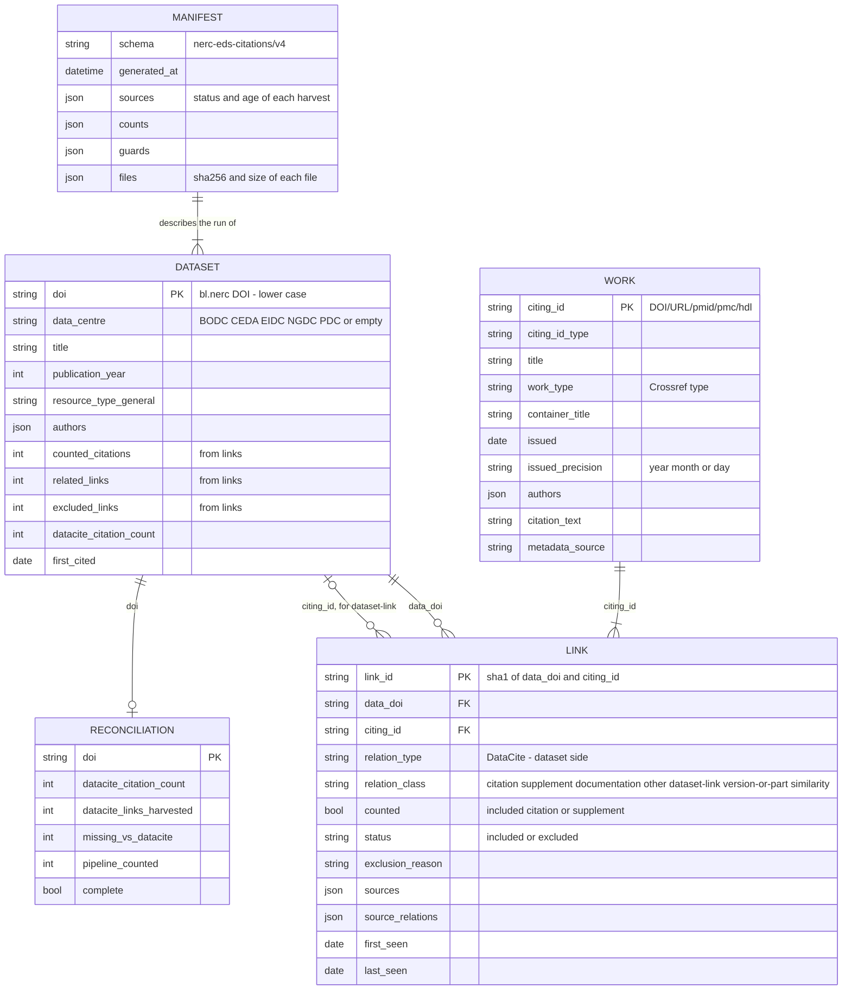

# Results/v4

> The published results. Written by `citations/publish.py`; the column lists below are its `*_COLUMNS` constants.

## Conventions

- DOIs are bare and lower case.
- Dates are ISO 8601: `YYYY`, `YYYY-MM` or `YYYY-MM-DD` for dates of works, at the precision known; `YYYY-MM-DDThh:mm:ssZ` for timestamps.
- Empty means null. There are no placeholders such as "Info not given".
- Lists and objects are JSON: a JSON string inside a CSV cell.
- Booleans are `true` and `false`.
- JSON files are flat arrays that carry `data_centre`; they are not grouped by data centre. `links.jsonl` is JSON Lines.
- Rows are sorted (datasets by DOI, links by dataset then citing work, works by id), so their order is stable between runs.
- CSV files are UTF-8 without a BOM, with LF line endings.
- Every file is written atomically. `manifest.json` is written last.

Every run sets `last_seen` on every link it still finds, so each week every row of `links.csv` and `links.jsonl` changes. The other files change only where the data does.

## Files

| File | One row per |
| --- | --- |
| `datasets.csv`, `datasets.json` | `bl.nerc` DOI, cited or not |
| `links.csv`, `links.jsonl` | dataset × citing work, excluded links included |
| `works.csv`, `works.json` | citing work used by at least one link |
| `reconciliation.csv` | dataset cited by DataCite or by the pipeline |
| `manifest.json` | run |

A link joins one dataset to one citing work, and every link, work and reconciliation row comes from the same run, which the manifest describes. When the citing work is itself a NERC dataset, its `citing_id` is that dataset's DOI and the link is a `dataset-link`.

## links

| Field | Type | Notes |
| --- | --- | --- |
| `link_id` | string | SHA-1 of `data_doi` + `\|` + `citing_id`; stable across runs |
| `data_doi` | string | the dataset |
| `data_centre` | string | `BODC`, `CEDA`, `EIDC`, `NGDC`, `PDC`, or empty |
| `citing_id` | string | see [identifiers](counting-rules.md#identifiers) |
| `citing_id_type` | string | `doi`, `url`, `pmid`, `pmc` or `handle` |
| `relation_type` | string | DataCite vocabulary, from the dataset's side |
| `relation_class` | string | see [relation classes](counting-rules.md#relation-classes) |
| `counted` | boolean | included `citation` or `supplement` |
| `status` | string | `included` or `excluded` |
| `exclusion_reason` | string | see [exclusions](counting-rules.md#exclusions); empty when included |
| `sources` | JSON list | e.g. `["datacite:crossref", "scholexplorer"]` |
| `source_relations` | JSON object | the raw relation each source reported, for audit |
| `first_seen` | date | when the link was first found; replaces v3's `date_added`, from which it was seeded on the first run |
| `last_seen` | date | the latest run that found it |

`sources` labels: `datacite` (a citation DataCite counts, with no event to say where it came from), `datacite:crossref` (journal reference lists Crossref deposits with DataCite), `datacite:metadata` (relations in DataCite metadata, the data centre's `relatedIdentifiers` among them), `datacite:<event source>` for any other event source, `scholexplorer`, `overton`, `crossref:datacitations`.

## works

| Field | Type | Notes |
| --- | --- | --- |
| `citing_id`, `citing_id_type` | string | as in links |
| `title` | string | |
| `work_type` | string | a [Crossref type](https://api.crossref.org/types) such as `journal-article`, `posted-content` or `dataset`. Other sources' types are mapped to it; Overton's policy documents are `report`; `other` when no Crossref type fits; empty when nothing is known |
| `container_title` | string | the journal, book or series |
| `publisher` | string | |
| `issued` | date | the issued date (not the DOI registration date) |
| `issued_precision` | string | `year`, `month` or `day` |
| `authors` | JSON list | `{given, family, name, orcid}`, empty keys left out |
| `citation_text` | string | plain text: formatted by the DOI's registration agency, else built from the metadata, else a link to the work |
| `metadata_source` | string | `crossref`, `datacite`, `inventory` (a NERC dataset), or the harvesting source when there is no DOI metadata |
| `fetched_at` | timestamp | when the metadata was fetched; empty when the Crossref or DataCite lookup failed and the source's own metadata is used until the next run retries it |

## datasets

| Field | Type | Notes |
| --- | --- | --- |
| `doi` | string | |
| `data_centre`, `data_centre_name` | string | code and full name, from the DataCite publisher; empty when the publisher matches no centre |
| `publisher`, `title` | string | from DataCite |
| `publication_year` | integer | |
| `resource_type_general` | string | DataCite's |
| `registered` | timestamp | DOI registration |
| `authors` | JSON list | as in works |
| `counted_citations` | integer | counted links |
| `related_links` | integer | included links that are not counted |
| `excluded_links` | integer | excluded links |
| `datacite_citation_count` | integer | DataCite's own `citationCount` |
| `first_cited` | date | issued date of the earliest counted citing work |

## reconciliation

For each dataset cited by DataCite or by the pipeline: `doi`, `data_centre`, `datacite_citation_count`, `datacite_links_harvested` (DataCite citing works harvested), `missing_vs_datacite`, `datacite_links_counted`, `datacite_links_dataset_link`, `datacite_links_excluded`, `datacite_links_other_class` (how DataCite's links were classified here), `pipeline_counted`, `pipeline_counted_not_in_datacite`, `pipeline_all_links` and `complete`. Sorted with the most missing first. See [Reconciliation](../3-features/reconciliation.md).

## manifest.json

| Key | Holds |
| --- | --- |
| `schema` | `nerc-eds-citations/v4` |
| `generated_at`, `code_version`, `git_commit`, `client_id` | the run |
| `settings` | the thresholds used |
| `sources` | for the inventory and each source: required or not, latest run and status, good run, its age, and whether it is stale |
| `counts` | datasets (in all, by centre, cited), links (in all, counted, by class, status and source), exclusions by reason, works |
| `reconciliation` | the reconciliation summary |
| `guards` | `problems`, `warnings`, and `forced` when published with `--force` despite problems |
| `v3_compat` | row counts of the v3 files, or null when not written |
| `files` | `sha256` and `bytes` of every other v4 file |

The files are fetched one by one, and `raw.githubusercontent.com` caches each for a few minutes, so a reader can be handed a new manifest with an old `links.csv`. Checking the hashes in `files` tells it the set is consistent before it uses it.
